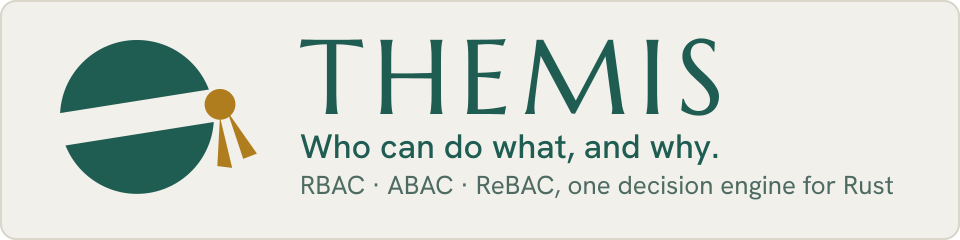

<p align="center">
  
</p>

# Strig

[](https://github.com/The-Hades-Organization/Strig/actions/workflows/ci.yml)
[](LICENSE)

[](https://crates.io/crates/strig)
[](https://docs.rs/strig)
[](https://www.npmjs.com/package/strig)

**English** · [Português (Brasil)](README.pt-BR.md)

An authorization library for Rust. A validated permission catalog and a decision engine that combines RBAC, ABAC and ReBAC over the same grants, with governance and auditing of changes, and real-time propagation of those changes all the way to the client.

The core does no IO, does not depend on an async runtime and compiles to WebAssembly. Real time, transports and bindings live in separate crates, each one optional.

> **Status:** pre-1.0. The API can still change between minor versions. Releases are published as `strig` on [crates.io](https://crates.io/crates/strig) (API docs on [docs.rs](https://docs.rs/strig)) and on [npm](https://www.npmjs.com/package/strig). Formerly Themis (crate `themis-auth`, npm package `themis-auth`): the project was renamed to Strig, see the [migration note](#migrating-from-themis).

## Crates

| Crate | What it is for | Notable dependencies |
|---|---|---|
| `strig` | Catalog, decision engine, governance, auditing (`audit` feature, on by default), JSON spec | `serde`, `thiserror`; `sha2` and `serde_json` with `audit` |
| `strig-sync` | Change hub, `Transport` trait, framework-independent SSE/WebSocket sessions, capability cache | `tokio` |
| `strig-redis` | `Transport` over Redis pub/sub | `redis` |
| `strig-postgres` | `Transport` over Postgres `LISTEN/NOTIFY`, with the notice sent inside the transaction | `tokio-postgres` |
| `strig-axum` | axum SSE and WebSocket routes over the `strig-sync` sessions | `axum` |
| `strig-inspect` | Inspector: the trace of each decision, grant simulation, access matrix and audit trail reading. Optional gpui window (`gui` feature) and terminal commands | `gpui-pre`, `gpui-component` |
| `strig-server` | HTTP decision server over an `Engine` and a grant source, and a Rust client with timeout and circuit breaker that denies when it gets no answer | `axum`, `hyper-util` (client) |
| `strig-macros` | `policy!` and `include_policy!`: a policy written in the DSL is validated while the crate compiles | `strig` |
| `strig-node` | JS bindings: native module (N-API) for Node and Bun, WebAssembly for the browser, real-time client and server in JS | `napi` or `wasm-bindgen` |

Depend on it from another crate:

```toml
[dependencies]
strig = "0.5"
strig-sync = "0.5"
```

## Concepts

| Concept | Type | Role |
|---|---|---|
| Catalog | `Catalog`, `PermissionDef` | Dotted keys (`document.invoice.export`), accepted targets, `implied_by`, free-form metadata (`meta`). Validated on construction: malformed key, duplicate, unregistered target, missing parent, cycle, and the application's own rules (`CatalogRule`). Exports and imports JSON. |
| Resource | `Resource`, `Anchor` | Path from the most specific to the broadest (`document:7 → doc_type:invoice → project:42 → org:9`), with an implicit `global` at the end, plus attributes. |
| Subject | `Subject` | Id, roles (optionally scoped), principals (`authenticated`, `anonymous` or your own), attributes. |
| Grant | `Grant` | Subject (`User`, `Role`, `Principal`, `Relation`, `Any`), permission, target, effect, optional scope and condition. |
| Engine | `Engine` | Overrides, collection of the applicable grants, combination by strategy. Returns a `Decision` with the reason, the matched grants and warnings. |
| Governance | `Governance`, `Invariant` | Applies a grant change only if every invariant passes, and records the outcome in the audit trail. |

## Usage

```rust
use strig::*;

let catalog = Catalog::builder()
    .target_kinds(["project", "doc_type", "document"])
    .broad_target("org")
    .permission(PermissionDef::new("document.export").targets(["project", "document"]))
    .permission(
        PermissionDef::new("document.invoice.export")
            .targets(["doc_type", "document"])
            .implied_by(["document.export"]),
    )
    .build()?;

let engine = Engine::builder(catalog)
    .override_with(ResourceOwner::new("owner"))
    .build()?;

let grants = vec![
    Grant::allow("g1", SubjectMatcher::role("member"), "document.export", TargetSelector::kind("org"))
        .scoped(Anchor::new("org", "acme")),
    Grant::deny("g2", SubjectMatcher::Any, "document.invoice.export", TargetSelector::exact("doc_type", "invoice")),
];

let dave = Subject::user("dave").with_role_in("member", Anchor::new("org", "acme"));
let invoice = Resource::new("document", "d1")
    .within("doc_type", "invoice")
    .within("project", "p1")
    .within("org", "acme");

let decision = engine.decide(&Context::new(&grants), &Request::new(&dave, "document.invoice.export", &invoice));
assert!(!decision.is_allowed()); // g2 sits on a more specific step than g1
```

The same configuration can come from JSON, TOML or YAML through `EngineSpec` (catalog, role inheritance, relations, strategy, overrides). `EngineSpec::builder()` returns the `EngineBuilder` so you can add in code what does not serialize, such as condition functions.

Examples: `cargo run -p strig --example documents` (the three models together) and `cargo run -p strig-axum --example server` (real-time server).

## How a decision is made

1. Permission not in the catalog: deny (`Reason::UnknownPermission`).
2. Overrides, in order. The first one that answers decides. `override_except` takes permissions (and the ones they imply) out of an override's reach.
3. Collection: a grant is a candidate when its permission is the requested one or one that implies it, its scope is on the resource path, its target matches a step of the path, its subject matches and its condition is true.
4. The strategy picks the deciding grant. With no candidate, deny.

A condition or relation that cannot be evaluated (missing attribute, engine without a `TupleStore`) never opens access: the `allow` is dropped and the `deny` is applied. The reason goes into `Decision::warnings`.

| Strategy | Rule |
|---|---|
| `MostSpecific` (default) | The most specific step with any grant decides; on that step, `deny` wins. |
| `DenyOverrides` | Any `deny` wins. |
| `PermitOverrides` | Any `allow` wins. |
| `FirstApplicable` | The first grant in source order decides. |

## The three models

**RBAC.** `RoleGraph::builder().inherit("maintainer", "member")` gives `maintainer` the grants of `member`. `Subject::with_role_in(role, anchor)` limits the role to the resources under that step.

**ABAC.** `Grant::when(condition)` with a serializable `Condition`: `eq`, `ne`, `lt`, `le`, `gt`, `ge`, `is_in`, `exists`, `all`, `any`, `not` and `call`, plus `starts_with`, `ends_with` and `contains` on text (`contains` also tests list membership), `any_in` and `all_in` on lists, `ip_in` for an address in a CIDR or a list of CIDRs, and `time_between` and `weekday_in` on the decision instant, always in UTC. The time conditions read the instant of `Context::at`; without one they cannot be resolved, so the `allow` does not apply. There is no regular-expression condition. Operands read `subject.*`, `resource.*` and `env.*`. Your own functions are added with `ConditionRegistry::register` and checked by `Engine::validate_grant`.

**ReBAC.** `object#relation@subject` tuples in a `TupleStore` and per-type rules in a `RelationSchema` (`This`, `Computed`, `TupleToUserset`, `Union`, `Intersection`, `Exclusion`), inspired by relationship-based access control. `user:*` stands for every user. A grant with `SubjectMatcher::relation("editor")` applies to whoever holds `editor` on the step matched by the target. The search has a maximum depth (`max_relation_depth`, 32 by default) and cuts cycles.

## Governance

```rust
let governance = Governance::new()
    .with(CatalogConformance)
    .with(RequirePermission::new("org.roles.edit", org_resource.clone()))
    .with(NoSelfManagement)
    .with(NoLockout::new(["org.invite"], members, org_resource))
    .with(Forbid::new(SubjectMatcher::principal(AUTHENTICATED), ["project.delete"]))
    .audited(auditor);

let next = governance.apply_with(&engine, &actor, &current, &Mutation::Add(grant), None, &request_meta)?;
// persist `next` only on Ok
```

Assigning or revoking a role goes through the same invariants and is audited as `role_assign`/`role_revoke`; the grant set comes back unchanged and the subject to persist comes from `Mutation::subject_after`.

```rust
let change = Mutation::AssignRole { subject: bob, role: RoleAssignment { role: "editor".into(), scope: Some(org) } };
governance.apply_with(&engine, &actor, &current, &change, None, &request_meta)?;
let bob = change.subject_after().expect("role change"); // persist bob's roles
```

`Forbid` applies to a role assignment only when it targets a user, and it ignores scope. `NoEscalation` keeps an actor from handing out what they do not hold: an `allow` grant or a role assignment is refused unless the actor holds every permission it confers, and each one it implies, where it would apply. See [Catalog governance](#catalog-governance).

Add your own rule by implementing `Invariant`. The list can also come from JSON (`InvariantSpec`).

## Catalog governance

The catalog carries the rules that governance enforces, so they live next to the permission they protect:

| Flag on `PermissionDef` | Effect |
|---|---|
| `depends_on` | Holding the permission requires holding each listed one on the same resource (`Prerequisites`). |
| `non_delegable` | Not delegable by whoever merely holds it: only a manager hands it out. |
| `management_only` | Grantable only to management roles. |
| `override_only` | Valid only through an override: a plain grant of it does not count. |

`NoEscalation` completes the set: an actor hands out only what they hold, so holding `org.roles.edit` is not a way to give someone a stronger role than your own. `NoLockout` can carry a reserve (`with_reserve`): when a change would leave a critical permission without a holder, the `Violation` brings a `Suggestion` with the role assignment that fixes it. Nothing is applied; the suggestion is also in the audit record. `RoleTemplate::materialize` turns a template of grants into ordinary grants, with the template id and version in the change metadata and no live link back.

```rust
let catalog = Catalog::builder()
    .target_kind("project")
    .permission(PermissionDef::new("project.view").targets(["project"]))
    .permission(PermissionDef::new("project.edit").targets(["project"]).depends_on(["project.view"]))
    .permission(PermissionDef::new("project.share").targets(["project"]).non_delegable())
    .permission(PermissionDef::new("project.purge").targets(["project"]).override_only())
    .build()?;
let engine = Engine::builder(catalog).build()?;

let governance = Governance::new()
    .with(CatalogConformance)
    .with(Prerequisites)
    .with(NoEscalation::new());

// `lead` holds `project.edit` only, so handing out `project.view` is an escalation.
let current = vec![Grant::allow("l", SubjectMatcher::user("lead"), "project.edit", TargetSelector::kind("project"))];
let handout = Mutation::Add(Grant::allow("a", SubjectMatcher::user("ana"), "project.view", TargetSelector::kind("project")));
let refused = governance.apply(&engine, &Subject::user("lead"), &current, &handout, None).unwrap_err();
assert_eq!(refused[0].invariant, "no_escalation");
```

## Auditing

With the `audit` feature, every change that goes through governance becomes an `AuditRecord`, whether applied or refused. ReBAC tuples and role assignments are recorded with `Auditor::tuple_change` and `Auditor::role_change`. If the sink fails to write, governance refuses the change with the `audit` violation: no record, no change.

```rust
let auditor = Arc::new(Auditor::new(AuditLevel::Standard, Arc::new(JsonLinesAudit::new(file))));
```

Built-in sinks: `MemoryAuditLog` and `JsonLinesAudit` (any `io::Write`). A database, queue or SIEM plugs in by implementing `AuditSink`.

### Levels and storage

Each level includes everything from the previous one. Sizes come from the reference record (`audit::reference_record`): a grant with a scope and a two-clause condition, UUID ids, an actor with two roles and three request metadata entries. They are compact JSON bytes in JSON Lines, without compression or indexes. The `estimates_match_reference_records` test fails if the measured size drifts more than 10% from the documented one, and `cargo run -p strig --example audit_storage` measures again.

| Level | What it keeps | Bytes per record | Per 1 million records |
|---|---|---|---|
| `minimal` | When, who, action, object id, outcome | 175 | 175 MB (167 MiB) |
| `standard` | Plus the grant summary (permission, subject, target, effect, scope, whether it has a condition) and the names of the invariants that refused | 388 | 388 MB (370 MiB) |
| `detailed` | Plus the whole grant with its condition, the full actor, the violation messages and the request metadata | 1,097 | 1.10 GB (1,046 MiB) |
| `forensic` | Plus the SHA-256 digest of the grant set before and after, and the hash chain between records | 1,415 | 1.42 GB (1,349 MiB) |

Access decisions can be audited too: `Auditor::decide(&engine, &ctx, &request, &meta)` decides and records, and at the `forensic` level it uses `Engine::explain` and keeps the full trace. Reference record: three grants in the source (one with a condition), a resource with three steps, UUID ids and three metadata entries (`audit::reference_decision_record`, test `decision_estimates_match_reference_records`).

| Level | What it keeps from a decision | Bytes per record | Per 1 million records |
|---|---|---|---|
| `minimal` | When, subject, `permission@resource`, allowed or denied | 285 | 285 MB (272 MiB) |
| `standard` | Plus the reason (override, deciding grant and step, or no grant) and the grants that matched | 669 | 669 MB (638 MiB) |
| `detailed` | Plus the full subject and resource, the warnings and the request metadata; enough to re-evaluate the decision later | 1,239 | 1.24 GB (1,182 MiB) |
| `forensic` | Plus the full trace (`Explanation`) and the hash chain | 3,582 | 3.58 GB (3,416 MiB) |

The forensic trace grows with the number of grants the source returns per decision. `AuditLevel::estimate_decision_bytes(n)` gives the projection in code.

`AuditLevel::estimate_bytes(n)` returns the same projection for changes. In a database, add the row overhead (in Postgres, about 28 bytes between the tuple header and the item pointer) and the indexes you create. Long conditions or large metadata grow `detailed` and `forensic` proportionally.

At the `forensic` level, each record carries the hash of the previous one. `audit::verify_chain` detects an edited or removed record. `Auditor::resume_chain` continues the chain after a restart.

## Validity windows

`Grant::valid_between(from, until)` (or `valid_from` and `valid_until`) limits a grant in time, in milliseconds since the Unix epoch. The window is closed at the start and open at the end. The instant comes from the caller: `Context::at(now)` for decisions and `Governance::at(now)` for changes. Without an instant, a grant with a window does not apply, so a missing clock fails closed. `CapabilityCache` cuts its entries at the next boundary, and a job removes the expired grants.

```rust
let grant = Grant::allow("w", SubjectMatcher::user("ana"), "project.view", TargetSelector::kind("project"))
    .valid_between(1_000, 2_000);
let grants = vec![grant];
let ana = Subject::user("ana");
let project = Resource::new("project", "p1");
let request = Request::new(&ana, "project.view", &project);

assert!(engine.check(&Context::new(&grants).at(1_500), &request));
assert!(!engine.check(&Context::new(&grants).at(2_000), &request));
assert!(!engine.check(&Context::new(&grants), &request));
```

## Reverse queries and filtered listing

Instead of asking "may this subject do this?", ask who can, or what a subject can reach. `QueryContext` carries the grants (and `.at(now)`); `QueryLimits` bounds the work and `PgTables` maps the same questions to SQL.

| Call | Answers |
|---|---|
| `engine.list(&qctx, &subject, permission, kind)` | An `AccessFilter` for the resources of that kind the subject can reach, to turn into a `WHERE`. |
| `engine.who_can(&qctx, permission)` | The parties named by an allow grant of the permission, anywhere. A deny, an override or a condition is not evaluated; `who_can_on` settles that for one resource. |
| `engine.who_can_on(..)` | The same, on one resource. |
| `engine.access_of(..)` | Every party with access to a resource, with the permissions of each. |
| `engine.check_for(..)` | A check for a subject reference: a `SubjectResolver` loads the subject and the answer names the path that decided. |

```rust
let qctx = QueryContext::new(&grants).at(1_500);
let filter = engine.list(&qctx, &ana, "project.view", "project");
let who = engine.who_can(&qctx, "project.view");
assert_eq!(who, vec![SubjectRef::User { id: "ana".into() }]);
```

## Exclusive resources

With the `exclusive` feature, a resource can have one holder at a time. `Terms::new(priority, ttl_ms)` states how strong the claim is and for how long; a higher priority takes the resource over only when the claimant also holds `exclusive.preempt`. Permissions and time are checked by the same engine as any other decision.

```rust
let mut registry = ExclusiveRegistry::default();
let now = 0; // milliseconds since the Unix epoch, passed by the caller
let first = registry.acquire_checked(&engine, &ctx, &ana, &document, Terms::new(1, 60_000), now)?;
assert_eq!(first, Acquisition::Granted);

let second = registry.acquire_checked(&engine, &ctx, &bob, &document, Terms::new(9, 60_000), now + 10)?;
assert!(matches!(second, Acquisition::Preempted { .. }));
```

## Real time

```text
grant change ──► Hub::publish ──► local sessions (SSE/WebSocket) and CapabilityCache
                      │
                      └─► Transport (Redis, Postgres, your own) ──► Hub on the other instances
```

The notice (`Change`) states the kind of change and the affected step, without the grants. Receivers reload from the source, so the notice fits any transport. A session watches scopes and, with a `CapabilityProvider`, pushes the capabilities of each affected scope back to the client. Changes that arrive together are recomputed once. When the transport drops and comes back, or a client falls behind, the hub emits `Resync` and everything is reloaded.

```rust
let hub = Hub::builder()
    .transport(RedisTransport::new("redis://127.0.0.1/", "strig:changes")?)
    .build();
let _relay = hub.spawn_relay();

let cache = Arc::new(CapabilityCache::new(Duration::from_secs(30), 10_000));
hub.on_change(cache.clone());
let provider = EngineProvider::new(engine, my_grant_loader).with_cache(cache);
let realtime = strig_axum::Realtime::new(hub).with_provider(Arc::new(provider));
// in the routes: realtime.sse(subject, scopes) or realtime.websocket(upgrade, subject, scopes)
```

Transports:

- **Redis** (`strig-redis`): pub/sub, publishing with automatic reconnection.
- **Postgres** (`strig-postgres`): `LISTEN/NOTIFY`. Calling `strig_postgres::notify(&tx, channel, &change)` inside the transaction that writes the grant makes the notice go out only on commit. TLS through `PgTransport::with_tls`.
- **Your own**: NATS, Kafka or any other broker implements `Transport` (`publish` and `subscribe`).

Client protocol (JSON, identical over SSE and WebSocket): the server sends `hello`, `capabilities`, `change`, `resync`, `error` and `ping`; the client sends `watch`, `unwatch` and `refresh` (WebSocket only). To use another HTTP framework, forward the stream from `Session::open` and write each message with `ServerMessage::to_sse` or `to_json`.

## Decision server and remote client

`strig-server` answers decisions over HTTP, for services that do not embed the engine. `DecisionServer::router()` returns an axum `Router` with `POST /v1/check`, `/v1/check/batch`, `/v1/list`, `/v1/who` and `/v1/access`, plus `GET /health/live` and `/health/ready`. The server reads the grants through a `DecisionSource`; `MemorySource` holds a `Snapshot` you can `replace`. The time of a decision is the server's clock. The contract is in [`crates/strig-server/API.md`](crates/strig-server/API.md).

```rust
let source = Arc::new(MemorySource::new(Snapshot::new(Arc::new(engine), grants)));
let router = DecisionServer::new(source).router();
let listener = tokio::net::TcpListener::bind("127.0.0.1:8080").await?;
axum::serve(listener, router).await?;
```

The client fails closed: only a `200` is an answer. A timeout, a refused connection, a `503` or an answer it cannot read becomes `ClientDecision::Denied` with the reason, and a circuit breaker stops calling a server that keeps failing.

```rust
let config = ClientConfig::default()
    .with_timeout(Duration::from_millis(250))
    .with_breaker(BreakerConfig::default().with_failure_threshold(5).with_open_for(Duration::from_secs(10)));
let client = Client::http("http://127.0.0.1:8080", config);

let request = CheckRequest::new(Subject::user("alice"), "document.view", Resource::new("document", "d1"));
if client.check(&request).await.is_allowed() {
    // serve the document
}
```

## JavaScript: Node, Bun and the browser

Install with `npm install strig`. The package lives in `crates/strig-node/js`. `scripts/build.sh` builds the native module (`js/native/strig.<platform>-<arch>.node`) and the WebAssembly (`js/wasm/`).

```js
import { load } from 'strig';
const { Engine, Context } = await load(); // native on Node/Bun, wasm in the browser

const engine = new Engine(spec); // the same EngineSpec as the server
const ctx = new Context({ grants });
engine.check(ctx, { subject, permission: 'document.view', resource });
engine.apply({ actor, current, mutation: { add: grant }, invariants, audit: { level: 'standard' } });
```

On Node and Bun, `load()` tries the native module and falls back to wasm. `STRIG_BACKEND=native|wasm` forces one of them.

**Frontend.** `PermissionClient` (`/client`) connects over SSE or WebSocket, keeps the capabilities of each scope and decides locally with the same engine. Client-side decisions are for the interface; the server still decides on every operation.

```js
import { PermissionClient } from 'strig/client';
const client = new PermissionClient({ url: '/permissions/events', scopes, strig, engine }).connect();
client.on('capabilities', () => render());
client.can('document.edit', resource);
```

**JS backend** (`/server`). `Hub`, `openSession`, `sseResponse` (Fetch API: Bun.serve, Hono, Deno), `pipeSse` (Node's `http`) and the `redisTransport` (node-redis and Bun's `RedisClient`), `ioredisTransport` and `pgTransport` (`pg` package) transports. Notices share the `strig-sync` format, so Rust and JS instances exchange changes over the same channel.

**Web frameworks.** Express, Fastify and NestJS decide on each route with the same options. `subject(req)` returns the subject (nothing means `401`), `resource(req)` the resource, and exactly one of `local: { engine, context, now }` or `remote: RemoteClient` says where the decision comes from. A deny is `403`, a failure to decide is `503`, and an error in your extractor is `500` with no detail, never a pass. `denyStatus`, `failureStatus`, `unauthenticatedStatus`, `errorStatus` and `onError` change that.

```js
import { load, scopeFromString } from 'strig';
import { authorize } from 'strig/express';

const { Engine, Context } = await load();
const options = {
  subject: (req) => (req.headers['x-user'] ? { kind: 'user', id: req.headers['x-user'] } : undefined),
  resource: (req) => scopeFromString(`document:${req.params.id}/org:o1`),
  local: { engine: new Engine(spec), context: new Context({ grants }), now: () => Date.now() },
};

app.get('/doc/:id', authorize({ ...options, permission: 'document.view' }), handler);
```

- **Fastify** (`strig/fastify`): the same `authorize`, and `plugin`, which adds `fastify.strigCan`.
- **NestJS** (`strig/nestjs`): `@Can('document.view')` on a handler or a controller, and `new StrigGuard(options)` as the guard. Express, Fastify and NestJS are optional peer dependencies; the integration you do not import costs nothing, and a missing peer raises `MissingPeerError`.
- **Remote** (`strig/remote`): `RemoteClient` talks to a decision server, with timeout and breaker, and denies when there is no answer. Pass it as `remote` instead of `local`.

```js
import { RemoteClient } from 'strig/remote';
const remote = new RemoteClient({ url: 'http://127.0.0.1:8080', timeoutMs: 250 });
const { allowed } = await remote.check({ subject, permission: 'document.view', resource });
```

Binding limits: custom condition functions (`call`) and custom overrides exist only in Rust. The JSON spec covers the built-in overrides (`resource_owner`, `permission_holder`).

## Policy language

A policy can be written as text instead of JSON, in the `dsl` feature of `strig`. There are three syntaxes for the same policy: Blocks, Rules and Actors, and `convert` moves between them. Every error carries a position and a hint, and the validated JSON stays the source of truth. The full guide, with the three syntaxes side by side and the grammar, is in [docs/dsl.md](docs/dsl.md).

```rust
use strig::dsl::{self, Language};

const SOURCE: &str = "language blocks

target_kinds = [org]

permission org.read {
  targets = [org]
}
";

let parsed = dsl::parse("policy.strig", SOURCE)?;
let json = parsed.policy.to_json()?;
let as_rules = dsl::convert(SOURCE, Language::Rules)?;
```

The conditions of `when` are written in the three syntaxes as `a starts_with b`, `env.ip ip_in "10.0.0.0/8"`, `time_between "09:00" "17:30"` and `weekday_in ["mon", "tue"]`; the validator refuses a CIDR, a time of day or a weekday it cannot read. When a name is a slip away from a declared one (a permission, a role, a parent), the hint adds ``did you mean `x`?``.

**Breaking in 0.5.0:** in the Rules and Actors syntaxes a `permission` line writes `depends_on <ids>` where it wrote `needs <ids>`, the same word as the JSON field. `needs` is now an error with the hint `write: depends_on <ids>`; replace it in existing `.strig` files, in the same position on the line. The JSON does not change.

`strig::dsl::format` and `is_formatted` rewrite a source in the canonical layout of its syntax, keeping the comments, and `strig-inspect fmt [--check] <file|dir>` does it for `.strig` files (`--check` lists the ones that would change and exits with 1).

To try the language without installing anything, run the [playground](playground/README.md): it runs the engine in the browser. There is no hosted copy; build and serve it locally:

```sh
sh playground/build.sh        # builds the WebAssembly engine and assembles playground/dist/
node playground/serve.mjs     # serves it on http://127.0.0.1:8080
```

With `dsl-fs`, `strig::dsl::fs::read_dir` reads every `*.strig` file of a directory into a `Project`, and `write_file` writes a policy back.

### Policy language in Node

The same language is in the JavaScript binding, native and WebAssembly, behind `load()`. The policy is the canonical JSON, with the comments in `notes`, and it is the same for the three syntaxes.

```js
import { load } from 'strig';
const strig = await load();

const source = `language blocks

target_kinds = [org]

permission org.read {
  targets = [org]
}
`;

const policy = strig.compile(source, { file: 'policy.strig' }); // canonical JSON
const rules = strig.print(policy, 'rules'); // 'blocks' | 'rules' | 'actors'
const actors = strig.convert(source, 'actors'); // text to text
const merged = strig.loadProject([
  { path: 'org.strig', text: source },
  { path: 'team.strig', text: strig.convert(source.replaceAll('org', 'team'), 'actors') },
]);
const fromDisk = strig.loadProjectDir?.('./policy'); // native module only
```

- `format(source)` returns the source in the canonical layout of its syntax and `isFormatted(source)` says whether it already is.
- `loadProjectDir(dir)` exists only on the native module, because the WebAssembly build has no file access. It reads the `*.strig` files of the directory and refuses a policy file that is a symbolic link. `dir` itself must come from a trusted source.
- Every failure is an `Error` with a `code` that is the same on both targets: `DSL_PARSE`, `DSL_VALIDATE`, `DSL_CONFLICT` (two sources declare the same thing; both positions are reported), `DSL_UNREPRESENTABLE` (the syntax cannot say it), `DSL_UNSUPPORTED`, `DSL_LIMIT` (a size or count limit), `DSL_DUPLICATE_SOURCE` (the same `path` twice in `loadProject`) and `DSL_IO` (a file or a link in `loadProjectDir`; the message carries the path, so do not pass it to a remote client).
- `error.diagnostics` is a list of `{ file, line, column, message, hint, related? }`, at most 100, with a last entry saying "and N more" when some were left out. `file`, `line` and `column` are `null` for a policy that did not come from text, and `related` (a `{ file, line, column }`) appears on a `DSL_CONFLICT`.

```js
try {
  strig.compile('language blocks\n\npermission {', { file: 'a.strig' });
} catch (error) {
  error.code; // 'DSL_PARSE'
  const [first] = error.diagnostics; // first.file === 'a.strig', first.line === 3
}
```

## Macros

`policy!` and `include_policy!` (crate `strig-macros`) check the policy while the crate compiles: a policy that does not validate does not build. They are not behind a `strig` feature; the guide explains [why](docs/dsl.md#macros).

```rust
use strig_macros::{include_policy, policy};

let inline: strig::dsl::Policy = policy!(r#"
language blocks

target_kinds = [org]

permission org.read {
  targets = [org]
}
"#);
let from_file: strig::dsl::Policy = include_policy!("policies/main.strig");
```

## Inspector (`strig-inspect`)

An optional crate, outside the `default-members`: `cargo build -p strig-inspect`. The window uses gpui (`gpui-pre =0.3.11` and `gpui-component =0.9.0`); without the `gui` feature (`--no-default-features`) you keep the library and the terminal commands.

```sh
strig-inspect --scenario scenario.json --audit trail.jsonl     # window
strig-inspect --scenario scenario.json --subject beto --permission document.export --resource fatura-7 \
               --disable pro-export --tab matriz                 # window opened on a selection and tab
strig-inspect explain --scenario scenario.json --subject beto --permission document.view --resource secret
strig-inspect matrix  --scenario scenario.json --resource secret --disable no-secret --add grant.json
strig-inspect audit   --audit trail.jsonl --scenario scenario.json
```

The scenario is a JSON file with the policy (`spec`, the same `EngineSpec`), the data (`grants`, `tuples`, `env`) and the subjects and resources to examine, by name. There is an example in `crates/strig-inspect/examples/scenario.json`, with a forensic trail of six decisions in `examples/audit.jsonl`, generated by:

```sh
cargo run -p strig-inspect --no-default-features --example trail -- \
    crates/strig-inspect/examples/scenario.json > crates/strig-inspect/examples/audit.jsonl
```

- **Evaluation** (`avaliacao`): pick a subject, permission and resource and see the decision, the reason, the resource path with the deciding step, the effective roles, each override and the fate of each grant (candidate, unrelated permission, out of scope, target off the path, subject does not match, condition false or not evaluable), with the condition tree and the resolved values. It is built on `Engine::explain`, also available from Rust and JS.
- **Simulation**: turn grants on and off (or add some with `--add`) and see whether the set would allow the access. When the decision changes, the panel also shows the decision with the original grants.
- **Matrix** (`matriz`): every catalog permission for every subject on a resource, with the cells the simulation changed marked. Clicking a cell opens its trace.
- **Audit** (`auditoria`): reads the JSON Lines trail, checks the hash chain of the `forensic` records, shows the recorded trace and re-evaluates `detailed` or `forensic` decisions against the current policy, pointing out the ones that would change.

`strig-inspect fmt [--check] <file|dir>` formats `.strig` files without opening the window. Files are reloaded on their own when they change on disk. The window follows the system light or dark appearance, with the palette of the playground: jade for structure and allow, clay for deny, gold for who, where and numbers. The window embeds the Noto Sans and JetBrains Mono fonts (OFL license, in `crates/strig-inspect/assets/fonts`) and its own icons, so it looks the same on any machine. The interface text is in Brazilian Portuguese.

## Extension points

| Trait | For |
|---|---|
| `GrantSource` | Reading grants from a database, a cache or more than one source (`(A, B)` tuples chain). |
| `TupleStore` | Keeping ReBAC tuples outside memory. |
| `Override` | Owner, superadmin, suspended account, maintenance window. `FnOverride` takes a closure. |
| `Strategy` | Another combination rule. |
| `Invariant` | Another grant change rule. |
| `CatalogRule` | Your own catalog validation (`RequireMeta`, `FnRule`). |
| `AuditSink` | Where the audit trail goes. |
| `Transport` | The medium between instances for change notices. |
| `CapabilityProvider`, `GrantLoader` | How a session computes the capabilities it sends. |
| `ChangeSink` | A synchronous reaction to each change (cache, metric). |

## Development

```sh
cargo test --workspace
cargo clippy --workspace --all-targets -- -D warnings
cargo clippy -p strig-node --features napi -- -D warnings
cargo clippy -p strig-node --features wasm --target wasm32-unknown-unknown -- -D warnings
cargo fmt --all --check

# transports against real servers (skipped without the variables)
STRIG_REDIS_URL=redis://127.0.0.1:6379/ STRIG_PG_URL=postgres://postgres:pw@127.0.0.1/postgres cargo test --workspace

# JS: build and tests on Node and Bun
crates/strig-node/scripts/build.sh
cd crates/strig-node/js && npm install && node test/run.mjs && bun test/run.mjs
```

The JS tests also accept `STRIG_RUST_SERVER` (the URL of the `strig-axum` `server` example) to test the client against the Rust server.

The gpui window of `strig-inspect` needs the Wayland and X11 development libraries on Linux (for example `libxkbcommon-dev`, `libwayland-dev`, `libxcb1-dev`, `libvulkan-dev`).

Source comments and the inspector interface are in Brazilian Portuguese; issues and pull requests are welcome in English or Portuguese. See [CONTRIBUTING.md](CONTRIBUTING.md).

## Migrating from Themis

Strig was called Themis until 0.5.0. The code is the same; only names changed.

| Before | Now |
|---|---|
| crate `themis-auth` (library `themis`) | crate `strig` (library `strig`) |
| `themis-sync`, `themis-redis`, `themis-postgres`, `themis-axum`, `themis-macros`, `themis-server` | `strig-sync`, `strig-redis`, `strig-postgres`, `strig-axum`, `strig-macros`, `strig-server` |
| npm package `themis-auth` | npm package `strig` |
| `themis-inspect` | `strig-inspect` |
| `.themis` policy files | `.strig` policy files |
| `THEMIS_*` environment variables | `STRIG_*` environment variables |

Replace `use themis::` with `use strig::` and rename the files and variables above. The repository moved to [The-Hades-Organization/Strig](https://github.com/The-Hades-Organization/Strig).

## License

[MIT](LICENSE). The fonts embedded in `strig-inspect` are under the SIL Open Font License 1.1 (see `crates/strig-inspect/assets/fonts`).
