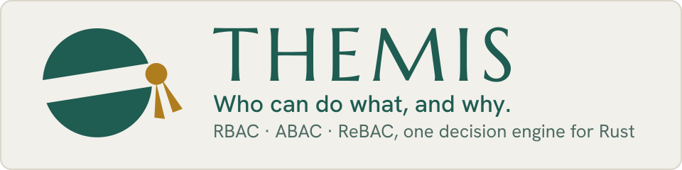

<p align="center">
  
</p>

# Themis

[](https://github.com/The-Hades-Organization/Themis/actions/workflows/ci.yml)
[](LICENSE)

[](https://crates.io/crates/themis-auth)
[](https://docs.rs/themis-auth)
[](https://www.npmjs.com/package/themis-auth)

[English](README.md) · **Português (Brasil)**

Biblioteca de autorização em Rust. Um catálogo de permissões validado e um motor de decisão que combina RBAC, ABAC e ReBAC sobre os mesmos grants, com governança e auditoria das mudanças e propagação das mudanças em tempo real até o cliente.

O núcleo não faz IO, não depende de runtime assíncrono e compila para WebAssembly. Tempo real, transportes e bindings ficam em crates separados, cada um opcional.

> **Estado:** antes da 1.0. A API ainda pode mudar entre versões menores. As versões saem como `themis-auth` no [crates.io](https://crates.io/crates/themis-auth) (documentação da API no [docs.rs](https://docs.rs/themis-auth)) e no [npm](https://www.npmjs.com/package/themis-auth). A biblioteca mantém o nome `themis`: `use themis::...`.

## Crates

| Crate | Para que serve | Dependências relevantes |
|---|---|---|
| `themis-auth` | Catálogo, motor de decisão, governança, auditoria (feature `audit`, ligada por padrão), spec em JSON | `serde`, `thiserror`; `sha2` e `serde_json` com `audit` |
| `themis-sync` | Hub de mudanças, trait `Transport`, sessões SSE/WebSocket independentes de framework, cache de capacidades | `tokio` |
| `themis-redis` | `Transport` sobre Redis pub/sub | `redis` |
| `themis-postgres` | `Transport` sobre Postgres `LISTEN/NOTIFY`, com aviso dentro da transação | `tokio-postgres` |
| `themis-axum` | Rotas SSE e WebSocket do axum sobre as sessões do `themis-sync` | `axum` |
| `themis-inspect` | Visualizador: rastro de cada decisão, simulação de grants, matriz de acesso e leitura da auditoria. Janela gpui opcional (feature `gui`) e comandos de terminal | `gpui-pre`, `gpui-component` |
| `themis-server` | Servidor HTTP de decisão sobre um `Engine` e uma fonte de grants, e cliente Rust com timeout e circuit breaker que nega quando não recebe resposta | `axum`, `hyper-util` (cliente) |
| `themis-macros` | `policy!` e `include_policy!`: a política escrita na DSL é validada enquanto o crate compila | `themis-auth` |
| `themis-node` | Bindings JS: módulo nativo (N-API) para Node e Bun, WebAssembly para navegador, cliente e servidor de tempo real em JS | `napi` ou `wasm-bindgen` |

Dependência a partir de outro crate:

```toml
[dependencies]
themis = { package = "themis-auth", version = "0.4" }
themis-sync = "0.4"
```

## Conceitos

| Conceito | Tipo | Papel |
|---|---|---|
| Catálogo | `Catalog`, `PermissionDef` | Chaves pontilhadas (`document.invoice.export`), alvos aceitos, `implied_by`, metadados livres (`meta`). Validado na construção: chave mal formada, duplicata, alvo não registrado, pai inexistente, ciclo e as regras da aplicação (`CatalogRule`). Exporta e importa JSON. |
| Recurso | `Resource`, `Anchor` | Caminho do mais específico ao mais amplo (`document:7 → doc_type:invoice → project:42 → org:9`), `global` implícito no fim, mais atributos. |
| Sujeito | `Subject` | Id, papéis (com escopo opcional), principais (`authenticated`, `anonymous` ou próprios), atributos. |
| Grant | `Grant` | Sujeito (`User`, `Role`, `Principal`, `Relation`, `Any`), permissão, alvo, efeito, escopo e condição opcionais. |
| Motor | `Engine` | Overrides, coleta dos grants aplicáveis, combinação por estratégia. Devolve `Decision` com motivo, grants casados e avisos. |
| Governança | `Governance`, `Invariant` | Aplica uma mudança de grant só se todos os invariantes passarem, e registra a decisão na auditoria. |

## Uso

```rust
use themis::*;

let catalog = Catalog::builder()
    .target_kinds(["project", "doc_type", "document"])
    .broad_target("org")
    .permission(PermissionDef::new("document.export").targets(["project", "document"]))
    .permission(
        PermissionDef::new("document.invoice.export")
            .targets(["doc_type", "document"])
            .implied_by(["document.export"]),
    )
    .build()?;

let engine = Engine::builder(catalog)
    .override_with(ResourceOwner::new("owner"))
    .build()?;

let grants = vec![
    Grant::allow("g1", SubjectMatcher::role("member"), "document.export", TargetSelector::kind("org"))
        .scoped(Anchor::new("org", "acme")),
    Grant::deny("g2", SubjectMatcher::Any, "document.invoice.export", TargetSelector::exact("doc_type", "invoice")),
];

let dave = Subject::user("dave").with_role_in("member", Anchor::new("org", "acme"));
let invoice = Resource::new("document", "d1")
    .within("doc_type", "invoice")
    .within("project", "p1")
    .within("org", "acme");

let decision = engine.decide(&Context::new(&grants), &Request::new(&dave, "document.invoice.export", &invoice));
assert!(!decision.is_allowed()); // g2 está num degrau mais específico que g1
```

A mesma configuração pode vir de JSON, TOML ou YAML por `EngineSpec` (catálogo, herança de papéis, relações, estratégia, overrides). `EngineSpec::builder()` devolve o `EngineBuilder` para acrescentar em código o que não serializa, como funções de condição.

Exemplos: `cargo run -p themis-auth --example documents` (os três modelos juntos) e `cargo run -p themis-axum --example server` (servidor de tempo real).

## Como a decisão sai

1. Permissão fora do catálogo: nega (`Reason::UnknownPermission`).
2. Overrides, em ordem. O primeiro que responder decide. `override_except` tira permissões (e as que elas concedem) do alcance de um override.
3. Coleta: entra o grant cuja permissão é a pedida ou uma que a concede, cujo escopo está no caminho do recurso, cujo alvo casa um degrau do caminho, cujo sujeito casa e cuja condição é verdadeira.
4. A estratégia escolhe o grant decisivo. Sem candidato, nega.

Condição ou relação que não pode ser avaliada (atributo ausente, motor sem `TupleStore`) não abre acesso: o `allow` é descartado e o `deny` é aplicado. O motivo vai em `Decision::warnings`.

| Estratégia | Regra |
|---|---|
| `MostSpecific` (padrão) | O degrau mais específico com algum grant decide; nele, `deny` vence. |
| `DenyOverrides` | Qualquer `deny` vence. |
| `PermitOverrides` | Qualquer `allow` vence. |
| `FirstApplicable` | O primeiro grant na ordem da fonte decide. |

## Os três modelos

**RBAC.** `RoleGraph::builder().inherit("maintainer", "member")` dá ao `maintainer` os grants do `member`. `Subject::with_role_in(role, anchor)` limita o papel aos recursos sob aquele degrau.

**ABAC.** `Grant::when(condition)` com `Condition` serializável: `eq`, `ne`, `lt`, `le`, `gt`, `ge`, `is_in`, `exists`, `all`, `any`, `not` e `call`. Operandos leem `subject.*`, `resource.*` e `env.*`. Funções próprias entram por `ConditionRegistry::register` e são conferidas por `Engine::validate_grant`.

**ReBAC.** Tuplas `objeto#relação@sujeito` num `TupleStore` e regras por tipo em `RelationSchema` (`This`, `Computed`, `TupleToUserset`, `Union`, `Intersection`, `Exclusion`), inspirado no controle de acesso baseado em relações. `user:*` vale para todo usuário. Um grant com `SubjectMatcher::relation("editor")` se aplica a quem tem `editor` sobre o degrau casado pelo alvo. A busca tem profundidade máxima (`max_relation_depth`, padrão 32) e corta ciclos.

## Governança

```rust
let governance = Governance::new()
    .with(CatalogConformance)
    .with(RequirePermission::new("org.roles.edit", org_resource.clone()))
    .with(NoSelfManagement)
    .with(NoLockout::new(["org.invite"], members, org_resource))
    .with(Forbid::new(SubjectMatcher::principal(AUTHENTICATED), ["project.delete"]))
    .audited(auditor);

let next = governance.apply_with(&engine, &actor, &current, &Mutation::Add(grant), None, &request_meta)?;
// grava `next` só no Ok
```

Atribuir ou revogar papel passa pelos mesmos invariantes e vai para a auditoria como `role_assign`/`role_revoke`; o conjunto de grants volta igual e o sujeito a gravar sai de `Mutation::subject_after`.

```rust
let change = Mutation::AssignRole { subject: bob, role: RoleAssignment { role: "editor".into(), scope: Some(org) } };
governance.apply_with(&engine, &actor, &current, &change, None, &request_meta)?;
let bob = change.subject_after().expect("mudança de papel"); // grava os papéis de bob
```

O `Forbid` vale para atribuição de papel só quando mira um usuário, e sem olhar escopo. O `NoEscalation` impede que um ator entregue o que ele não tem: um grant `allow` ou uma atribuição de papel é recusado se o ator não tiver cada permissão que ele confere, e cada uma que ela implica, onde valeria. Veja [Governança do catálogo](#governança-do-catálogo).

Regra própria entra implementando `Invariant`. A lista também pode vir de JSON (`InvariantSpec`).

## Governança do catálogo

O catálogo carrega as regras que a governança aplica, então elas ficam junto da permissão que protegem:

| Marca no `PermissionDef` | Efeito |
|---|---|
| `depends_on` | Ter a permissão exige ter cada uma das listadas no mesmo recurso (`Prerequisites`). |
| `non_delegable` | Não é delegável por quem apenas a tem: só um gestor a entrega. |
| `management_only` | Só pode ser concedida a papéis de gestão. |
| `override_only` | Vale só por um override: um grant comum dela não conta. |

O `NoEscalation` completa o conjunto: o ator entrega só o que tem, então ter `org.roles.edit` não é um jeito de dar a alguém um papel mais forte que o seu. O `NoLockout` aceita uma reserva (`with_reserve`): quando uma mudança deixaria uma permissão crítica sem titular, a `Violation` traz uma `Suggestion` com a atribuição de papel que corrige. Nada é aplicado; a sugestão também vai no registro de auditoria. `RoleTemplate::materialize` transforma um modelo de grants em grants comuns, com o id e a versão do modelo nos metadados da mudança e sem vínculo vivo com ele.

```rust
let catalog = Catalog::builder()
    .target_kind("project")
    .permission(PermissionDef::new("project.view").targets(["project"]))
    .permission(PermissionDef::new("project.edit").targets(["project"]).depends_on(["project.view"]))
    .permission(PermissionDef::new("project.share").targets(["project"]).non_delegable())
    .permission(PermissionDef::new("project.purge").targets(["project"]).override_only())
    .build()?;
let engine = Engine::builder(catalog).build()?;

let governance = Governance::new()
    .with(CatalogConformance)
    .with(Prerequisites)
    .with(NoEscalation::new());

// `lead` tem só `project.edit`, então entregar `project.view` é escalada.
let current = vec![Grant::allow("l", SubjectMatcher::user("lead"), "project.edit", TargetSelector::kind("project"))];
let handout = Mutation::Add(Grant::allow("a", SubjectMatcher::user("ana"), "project.view", TargetSelector::kind("project")));
let refused = governance.apply(&engine, &Subject::user("lead"), &current, &handout, None).unwrap_err();
assert_eq!(refused[0].invariant, "no_escalation");
```

## Auditoria

Com a feature `audit`, toda mudança que passa pela governança vira um `AuditRecord`, aplicada ou recusada. Tuplas ReBAC e atribuições de papel são registradas por `Auditor::tuple_change` e `Auditor::role_change`. Se o destino falhar ao gravar, a governança recusa a mudança com a violação `audit`: sem registro, sem mudança.

```rust
let auditor = Arc::new(Auditor::new(AuditLevel::Standard, Arc::new(JsonLinesAudit::new(file))));
```

Destinos prontos: `MemoryAuditLog` e `JsonLinesAudit` (qualquer `io::Write`). Banco, fila ou SIEM entram implementando `AuditSink`.

### Níveis e armazenamento

Cada nível inclui tudo do anterior. Os tamanhos são do registro de referência (`audit::reference_record`): grant com escopo e condição de duas cláusulas, ids UUID, ator com dois papéis e três metadados de requisição. São bytes de JSON compacto em JSON Lines, sem compressão e sem índice. O teste `estimates_match_reference_records` falha se o tamanho medido se afastar mais de 10% do documentado, e `cargo run -p themis-auth --example audit_storage` mede de novo.

| Nível | O que guarda | Bytes por registro | Por 1 milhão de registros |
|---|---|---|---|
| `minimal` | Quando, quem, ação, id do objeto, resultado | 175 | 175 MB (167 MiB) |
| `standard` | Mais o resumo do grant (permissão, sujeito, alvo, efeito, escopo, se tem condição) e os nomes dos invariantes que recusaram | 388 | 388 MB (370 MiB) |
| `detailed` | Mais o grant inteiro com a condição, o ator completo, as mensagens das violações e os metadados da requisição | 1.097 | 1,10 GB (1.046 MiB) |
| `forensic` | Mais o digest SHA-256 do conjunto de grants antes e depois e a cadeia de hashes entre registros | 1.415 | 1,42 GB (1.349 MiB) |

Decisões de acesso também podem ser auditadas: `Auditor::decide(&engine, &ctx, &request, &meta)` decide e registra, e no nível `forensic` usa `Engine::explain` e guarda o rastro completo. Registro de referência: três grants na fonte (um com condição), recurso com três degraus, ids UUID e três metadados (`audit::reference_decision_record`, teste `decision_estimates_match_reference_records`).

| Nível | O que guarda de uma decisão | Bytes por registro | Por 1 milhão de registros |
|---|---|---|---|
| `minimal` | Quando, sujeito, `permissão@recurso`, permitido ou negado | 285 | 285 MB (272 MiB) |
| `standard` | Mais o motivo (override, grant decisivo e degrau, ou nenhum grant) e os grants que casaram | 669 | 669 MB (638 MiB) |
| `detailed` | Mais o sujeito e o recurso completos, os avisos e os metadados da requisição; dá para reavaliar a decisão depois | 1.239 | 1,24 GB (1.182 MiB) |
| `forensic` | Mais o rastro completo (`Explanation`) e a cadeia de hashes | 3.582 | 3,58 GB (3.416 MiB) |

O rastro forense cresce com o número de grants que a fonte entrega por decisão. `AuditLevel::estimate_decision_bytes(n)` dá a projeção em código.

`AuditLevel::estimate_bytes(n)` devolve a mesma projeção em código. Em banco, some o custo da linha (no Postgres, uns 28 bytes entre cabeçalho da tupla e ponteiro de item) e os índices que você criar. Condições longas ou metadados grandes aumentam `detailed` e `forensic` na mesma proporção.

No nível `forensic`, cada registro carrega o hash do anterior. `audit::verify_chain` detecta registro editado ou removido. `Auditor::resume_chain` continua a cadeia depois de um reinício.

## Validade com data

`Grant::valid_between(from, until)` (ou `valid_from` e `valid_until`) limita um grant no tempo, em milissegundos desde a época Unix. A janela é fechada no início e aberta no fim. O instante vem de quem chama: `Context::at(now)` nas decisões e `Governance::at(now)` nas mudanças. Sem instante, um grant com janela não vale, então a falta de relógio fecha o acesso. O `CapabilityCache` corta suas entradas na próxima borda, e um job remove os grants vencidos.

```rust
let grant = Grant::allow("w", SubjectMatcher::user("ana"), "project.view", TargetSelector::kind("project"))
    .valid_between(1_000, 2_000);
let grants = vec![grant];
let ana = Subject::user("ana");
let project = Resource::new("project", "p1");
let request = Request::new(&ana, "project.view", &project);

assert!(engine.check(&Context::new(&grants).at(1_500), &request));
assert!(!engine.check(&Context::new(&grants).at(2_000), &request));
assert!(!engine.check(&Context::new(&grants), &request));
```

## Consultas reversas e listagem filtrada

Em vez de perguntar "este sujeito pode?", pergunte quem pode, ou o que um sujeito alcança. O `QueryContext` leva os grants (e `.at(now)`); o `QueryLimits` limita o trabalho e o `PgTables` leva as mesmas perguntas para SQL.

| Chamada | Responde |
|---|---|
| `engine.list(&qctx, &subject, permission, kind)` | Um `AccessFilter` com os recursos daquele tipo que o sujeito alcança, para virar um `WHERE`. |
| `engine.who_can(&qctx, permission)` | As partes nomeadas por um grant `allow` da permissão, em qualquer lugar. Deny, override e condição não são avaliados; `who_can_on` resolve isso para um recurso. |
| `engine.who_can_on(..)` | O mesmo, em um recurso. |
| `engine.access_of(..)` | Cada parte com acesso a um recurso, com as permissões de cada uma. |
| `engine.check_for(..)` | Uma checagem para uma referência de sujeito: um `SubjectResolver` carrega o sujeito e a resposta diz o caminho que decidiu. |

```rust
let qctx = QueryContext::new(&grants).at(1_500);
let filter = engine.list(&qctx, &ana, "project.view", "project");
let who = engine.who_can(&qctx, "project.view");
assert_eq!(who, vec![SubjectRef::User { id: "ana".into() }]);
```

## Recurso exclusivo

Com a feature `exclusive`, um recurso tem um titular por vez. `Terms::new(prioridade, ttl_ms)` diz a força do pedido e por quanto tempo; uma prioridade maior toma o recurso só quando quem pede também tem `exclusive.preempt`. Permissões e tempo passam pelo mesmo engine de qualquer outra decisão.

```rust
let mut registry = ExclusiveRegistry::default();
let now = 0; // milissegundos desde a época Unix, informados por quem chama
let first = registry.acquire_checked(&engine, &ctx, &ana, &document, Terms::new(1, 60_000), now)?;
assert_eq!(first, Acquisition::Granted);

let second = registry.acquire_checked(&engine, &ctx, &bob, &document, Terms::new(9, 60_000), now + 10)?;
assert!(matches!(second, Acquisition::Preempted { .. }));
```

## Tempo real

```text
mudança de grant ──► Hub::publish ──► sessões locais (SSE/WebSocket) e CapabilityCache
                          │
                          └─► Transport (Redis, Postgres, próprio) ──► Hub das outras instâncias
```

O aviso (`Change`) diz o tipo da mudança e o degrau afetado, sem os grants. Quem recebe recarrega da fonte, então o aviso cabe em qualquer transporte. Uma sessão observa escopos e, com um `CapabilityProvider`, reenvia ao cliente as capacidades de cada escopo afetado. Mudanças que chegam juntas são recalculadas uma vez só. Quando o transporte cai e volta, ou um cliente fica para trás, o hub emite `Resync` e tudo é recarregado.

```rust
let hub = Hub::builder()
    .transport(RedisTransport::new("redis://127.0.0.1/", "themis:changes")?)
    .build();
let _relay = hub.spawn_relay();

let cache = Arc::new(CapabilityCache::new(Duration::from_secs(30), 10_000));
hub.on_change(cache.clone());
let provider = EngineProvider::new(engine, my_grant_loader).with_cache(cache);
let realtime = themis_axum::Realtime::new(hub).with_provider(Arc::new(provider));
// nas rotas: realtime.sse(subject, scopes) ou realtime.websocket(upgrade, subject, scopes)
```

Transportes:

- **Redis** (`themis-redis`): pub/sub, publicação com reconexão automática.
- **Postgres** (`themis-postgres`): `LISTEN/NOTIFY`. `themis_postgres::notify(&tx, canal, &change)` dentro da transação que grava o grant faz o aviso sair só no commit. TLS por `PgTransport::with_tls`.
- **Próprio**: NATS, Kafka ou outro broker implementam `Transport` (`publish` e `subscribe`).

Protocolo com o cliente (JSON, igual em SSE e WebSocket): o servidor manda `hello`, `capabilities`, `change`, `resync`, `error` e `ping`; o cliente manda `watch`, `unwatch` e `refresh` (só WebSocket). Para usar outro framework HTTP, passe o stream de `Session::open` adiante e escreva cada mensagem com `ServerMessage::to_sse` ou `to_json`.

## Servidor de decisão e cliente remoto

O `themis-server` responde decisões por HTTP, para serviços que não embutem o engine. `DecisionServer::router()` devolve um `Router` do axum com `POST /v1/check`, `/v1/check/batch`, `/v1/list`, `/v1/who` e `/v1/access`, mais `GET /health/live` e `/health/ready`. O servidor lê os grants por uma `DecisionSource`; a `MemorySource` guarda um `Snapshot` que você pode trocar com `replace`. O instante de uma decisão é o relógio do servidor. O contrato está em [`crates/themis-server/API.md`](crates/themis-server/API.md).

```rust
let source = Arc::new(MemorySource::new(Snapshot::new(Arc::new(engine), grants)));
let router = DecisionServer::new(source).router();
let listener = tokio::net::TcpListener::bind("127.0.0.1:8080").await?;
axum::serve(listener, router).await?;
```

O cliente falha fechado: só um `200` é resposta. Timeout, conexão recusada, `503` ou uma resposta ilegível viram `ClientDecision::Denied` com o motivo, e um circuit breaker deixa de chamar um servidor que não para de falhar.

```rust
let config = ClientConfig::default()
    .with_timeout(Duration::from_millis(250))
    .with_breaker(BreakerConfig::default().with_failure_threshold(5).with_open_for(Duration::from_secs(10)));
let client = Client::http("http://127.0.0.1:8080", config);

let request = CheckRequest::new(Subject::user("alice"), "document.view", Resource::new("document", "d1"));
if client.check(&request).await.is_allowed() {
    // entregue o documento
}
```

## JavaScript: Node, Bun e navegador

Instale com `npm install themis-auth`. O pacote fica em `crates/themis-node/js`. `scripts/build.sh` gera o módulo nativo (`js/native/themis.<plataforma>-<arch>.node`) e o WebAssembly (`js/wasm/`).

```js
import { load } from 'themis-auth';
const { Engine, Context } = await load(); // nativo em Node/Bun, wasm no navegador

const engine = new Engine(spec); // a mesma EngineSpec do servidor
const ctx = new Context({ grants });
engine.check(ctx, { subject, permission: 'document.view', resource });
engine.apply({ actor, current, mutation: { add: grant }, invariants, audit: { level: 'standard' } });
```

Em Node e Bun, `load()` tenta o módulo nativo e cai para o wasm. `THEMIS_BACKEND=native|wasm` força um dos dois.

**Frontend.** `PermissionClient` (`/client`) conecta por SSE ou WebSocket, guarda as capacidades de cada escopo e decide localmente com o mesmo motor. A decisão no cliente serve para a interface; o servidor continua decidindo em toda operação.

```js
import { PermissionClient } from 'themis-auth/client';
const client = new PermissionClient({ url: '/permissions/events', scopes, themis, engine }).connect();
client.on('capabilities', () => render());
client.can('document.edit', resource);
```

**Backend em JS** (`/server`). `Hub`, `openSession`, `sseResponse` (Fetch API: Bun.serve, Hono, Deno), `pipeSse` (`http` do Node) e os transportes `redisTransport` (node-redis e o `RedisClient` do Bun), `ioredisTransport` e `pgTransport` (pacote `pg`). Os avisos têm o mesmo formato do `themis-sync`, então instâncias em Rust e em JS trocam mudanças pelo mesmo canal.

**Frameworks web.** Express, Fastify e NestJS decidem em cada rota com as mesmas opções. `subject(req)` devolve o sujeito (nada significa `401`), `resource(req)` o recurso, e exatamente um entre `local: { engine, context, now }` e `remote: RemoteClient` diz de onde vem a decisão. Negar é `403`, não conseguir decidir é `503`, e um erro no seu extrator é `500` sem detalhe, nunca uma passagem. `denyStatus`, `failureStatus`, `unauthenticatedStatus`, `errorStatus` e `onError` mudam isso.

```js
import { load, scopeFromString } from 'themis-auth';
import { authorize } from 'themis-auth/express';

const { Engine, Context } = await load();
const options = {
  subject: (req) => (req.headers['x-user'] ? { kind: 'user', id: req.headers['x-user'] } : undefined),
  resource: (req) => scopeFromString(`document:${req.params.id}/org:o1`),
  local: { engine: new Engine(spec), context: new Context({ grants }), now: () => Date.now() },
};

app.get('/doc/:id', authorize({ ...options, permission: 'document.view' }), handler);
```

- **Fastify** (`themis-auth/fastify`): o mesmo `authorize`, e o `plugin`, que acrescenta `fastify.themisCan`.
- **NestJS** (`themis-auth/nestjs`): `@Can('document.view')` em um handler ou controller, e `new ThemisGuard(options)` como guarda. Express, Fastify e NestJS são dependências peer opcionais; a integração que você não importa não custa nada, e um peer ausente lança `MissingPeerError`.
- **Remoto** (`themis-auth/remote`): o `RemoteClient` fala com um servidor de decisão, com timeout e breaker, e nega quando não há resposta. Passe-o como `remote` no lugar de `local`.

```js
import { RemoteClient } from 'themis-auth/remote';
const remote = new RemoteClient({ url: 'http://127.0.0.1:8080', timeoutMs: 250 });
const { allowed } = await remote.check({ subject, permission: 'document.view', resource });
```

Limites dos bindings: funções de condição próprias (`call`) e overrides próprios só existem em Rust. A spec em JSON cobre os overrides prontos (`resource_owner`, `permission_holder`).

## Linguagem de políticas

Uma política pode ser escrita como texto em vez de JSON, na feature `dsl` do `themis-auth`. São três sintaxes para a mesma política: Blocks, Rules e Actors, e o `convert` passa de uma para outra. Todo erro traz posição e dica, e o JSON validado continua sendo a fonte da verdade. O guia completo, com as três sintaxes lado a lado e a gramática, está em [docs/dsl.pt-BR.md](docs/dsl.pt-BR.md).

```rust
use themis::dsl::{self, Language};

const SOURCE: &str = "language blocks

target_kinds = [org]

permission org.read {
  targets = [org]
}
";

let parsed = dsl::parse("policy.themis", SOURCE)?;
let json = parsed.policy.to_json()?;
let as_rules = dsl::convert(SOURCE, Language::Rules)?;
```

Para experimentar a linguagem sem instalar nada, gere o [playground](playground/README.md): ele roda o motor no navegador.

Com `dsl-fs`, `themis::dsl::fs::read_dir` lê todos os arquivos `*.themis` de um diretório para um `Project`, e `write_file` grava uma política de volta.

### Linguagem de políticas no Node

A mesma linguagem está no binding JavaScript, nativo e WebAssembly, atrás do `load()`. A política é o JSON canônico, com os comentários em `notes`, e é a mesma para as três sintaxes.

```js
import { load } from 'themis-auth';
const themis = await load();

const source = `language blocks

target_kinds = [org]

permission org.read {
  targets = [org]
}
`;

const policy = themis.compile(source, { file: 'policy.themis' }); // JSON canônico
const rules = themis.print(policy, 'rules'); // 'blocks' | 'rules' | 'actors'
const actors = themis.convert(source, 'actors'); // texto para texto
const merged = themis.loadProject([
  { path: 'org.themis', text: source },
  { path: 'team.themis', text: themis.convert(source.replaceAll('org', 'team'), 'actors') },
]);
const fromDisk = themis.loadProjectDir?.('./policy'); // só o módulo nativo
```

- `loadProjectDir(dir)` existe só no módulo nativo, porque o build WebAssembly não acessa arquivos. Ele lê os arquivos `*.themis` do diretório e recusa um arquivo de política que seja link simbólico. O próprio `dir` deve vir de fonte confiável.
- Toda falha é um `Error` com um `code` igual nos dois alvos: `DSL_PARSE`, `DSL_VALIDATE`, `DSL_CONFLICT` (duas fontes declaram a mesma coisa; as duas posições são informadas), `DSL_UNREPRESENTABLE` (a sintaxe não consegue dizer isso), `DSL_UNSUPPORTED`, `DSL_LIMIT` (limite de tamanho ou de quantidade), `DSL_DUPLICATE_SOURCE` (o mesmo `path` duas vezes no `loadProject`) e `DSL_IO` (um arquivo ou um link no `loadProjectDir`; a mensagem traz o caminho, então não a repasse a um cliente remoto).
- `error.diagnostics` é uma lista de `{ file, line, column, message, hint, related? }`, no máximo 100, com uma última entrada dizendo "and N more" quando sobrou algo. `file`, `line` e `column` são `null` numa política que não veio de texto, e `related` (um `{ file, line, column }`) aparece num `DSL_CONFLICT`.

```js
try {
  themis.compile('language blocks\n\npermission {', { file: 'a.themis' });
} catch (error) {
  error.code; // 'DSL_PARSE'
  const [first] = error.diagnostics; // first.file === 'a.themis', first.line === 3
}
```

## Macros

`policy!` e `include_policy!` (crate `themis-macros`) conferem a política enquanto o crate compila: uma política que não valida não compila. Elas não ficam atrás de uma feature do `themis-auth`; o guia explica [o motivo](docs/dsl.pt-BR.md#macros).

```rust
use themis_macros::{include_policy, policy};

let inline: themis::dsl::Policy = policy!(r#"
language blocks

target_kinds = [org]

permission org.read {
  targets = [org]
}
"#);
let from_file: themis::dsl::Policy = include_policy!("policies/main.themis");
```

## Visualizador (`themis-inspect`)

Crate opcional, fora dos `default-members`: `cargo build -p themis-inspect`. A janela usa gpui (`gpui-pre =0.3.11` e `gpui-component =0.9.0`); sem a feature `gui` (`--no-default-features`) sobram a biblioteca e os comandos de terminal.

```sh
themis-inspect --scenario scenario.json --audit trail.jsonl     # janela
themis-inspect --scenario scenario.json --subject beto --permission document.export --resource fatura-7 \
               --disable pro-export --tab matriz                 # janela já numa seleção e aba
themis-inspect explain --scenario scenario.json --subject beto --permission document.view --resource secret
themis-inspect matrix  --scenario scenario.json --resource secret --disable no-secret --add grant.json
themis-inspect audit   --audit trail.jsonl --scenario scenario.json
```

O cenário é um JSON com a política (`spec`, a mesma `EngineSpec`), os dados (`grants`, `tuples`, `env`) e os sujeitos e recursos a examinar, por nome. Exemplo em `crates/themis-inspect/examples/sscenario.json`, com uma trilha forensic de seis decisões em `examples/audit.jsonl`, gerada por:

```sh
cargo run -p themis-inspect --no-default-features --example trail -- \
    crates/themis-inspect/examples/sscenario.json > crates/themis-inspect/examples/audit.jsonl
```

- **Avaliação**: escolha sujeito, permissão e recurso e veja a decisão, o motivo, o caminho do recurso com o degrau decisivo, os papéis efetivos, cada override e o destino de cada grant (candidato, permissão não relacionada, fora do escopo, alvo fora do caminho, sujeito não casa, condição falsa ou não avaliável), com a árvore da condição e os valores resolvidos. A base é `Engine::explain`, disponível também em Rust e JS.
- **Simulação**: ligue e desligue grants (ou acrescente pelo `--add`) e veja se o conjunto permitiria o acesso. Quando a decisão muda, o painel mostra também a decisão com os grants originais.
- **Matriz**: cada permissão do catálogo para cada sujeito sobre um recurso, com as células que a simulação mudou marcadas. Clicar numa célula abre o rastro.
- **Auditoria**: lê a trilha em JSON Lines, confere a cadeia de hashes dos registros `forensic`, mostra o rastro gravado e reavalia decisões `detailed` ou `forensic` contra a política atual, apontando as que mudariam.

Os arquivos são relidos sozinhos quando mudam no disco. A janela embute as fontes Noto Sans e JetBrains Mono (licença OFL, em `crates/themis-inspect/assets/fonts`) e os próprios ícones, então tem a mesma aparência em qualquer máquina.

## Pontos de extensão

| Trait | Para |
|---|---|
| `GrantSource` | Ler grants de banco, cache ou mais de uma fonte (tuplas `(A, B)` encadeiam). |
| `TupleStore` | Guardar tuplas ReBAC fora da memória. |
| `Override` | Dono, superadmin, conta suspensa, janela de manutenção. `FnOverride` aceita closure. |
| `Strategy` | Outra regra de combinação. |
| `Invariant` | Outra regra de mudança de grant. |
| `CatalogRule` | Validação própria do catálogo (`RequireMeta`, `FnRule`). |
| `AuditSink` | Destino da trilha de auditoria. |
| `Transport` | Meio entre instâncias para os avisos de mudança. |
| `CapabilityProvider`, `GrantLoader` | Como uma sessão calcula as capacidades que envia. |
| `ChangeSink` | Reação síncrona a cada mudança (cache, métrica). |

## Desenvolvimento

```sh
cargo test --workspace
cargo clippy --workspace --all-targets -- -D warnings
cargo clippy -p themis-node --features napi -- -D warnings
cargo clippy -p themis-node --features wasm --target wasm32-unknown-unknown -- -D warnings
cargo fmt --all --check

# transportes contra servidores reais (pulados sem as variáveis)
THEMIS_REDIS_URL=redis://127.0.0.1:6379/ THEMIS_PG_URL=postgres://postgres:pw@127.0.0.1/postgres cargo test --workspace

# JS: build e testes em Node e Bun
crates/themis-node/scripts/build.sh
cd crates/themis-node/js && npm install && node test/run.mjs && bun test/run.mjs
```

Os testes JS também aceitam `THEMIS_RUST_SERVER` (URL do example `server` do `themis-axum`) para testar o cliente contra o servidor Rust.

No Linux, a janela gpui do `themis-inspect` precisa das bibliotecas de desenvolvimento de Wayland e X11 (por exemplo `libxkbcommon-dev`, `libwayland-dev`, `libxcb1-dev`, `libvulkan-dev`).

Issues e pull requests são bem-vindos em português ou inglês. Veja [CONTRIBUTING.md](CONTRIBUTING.md).

## Licença

[MIT](LICENSE). As fontes embutidas no `themis-inspect` estão sob a SIL Open Font License 1.1 (veja `crates/themis-inspect/assets/fonts`).
